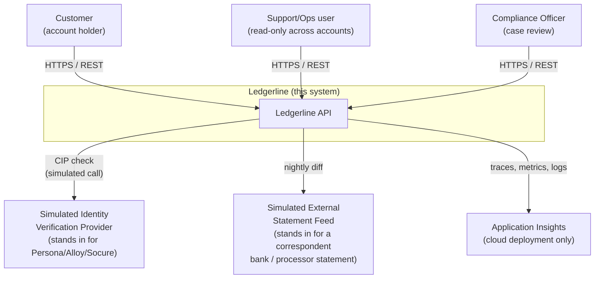
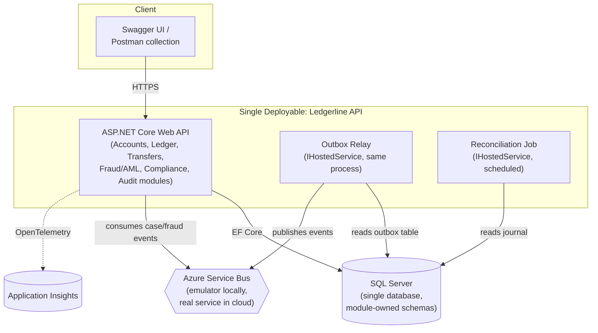
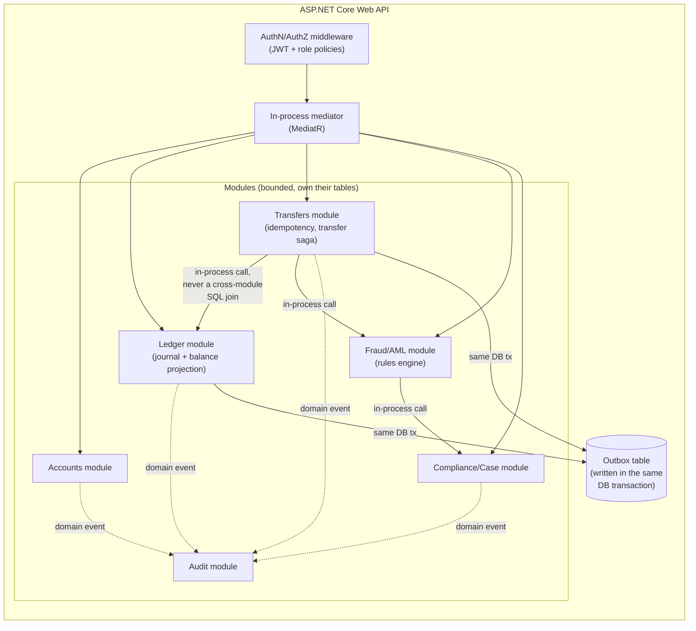
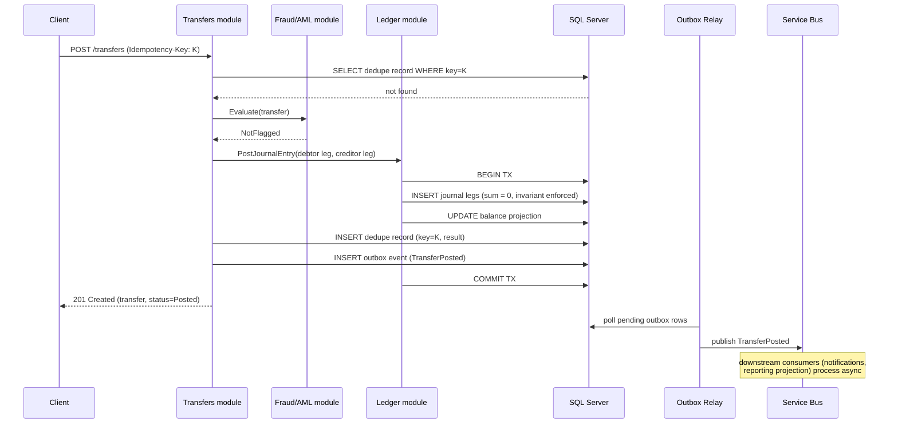
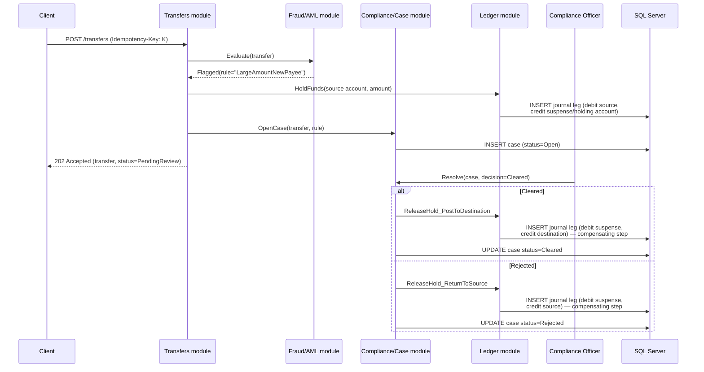
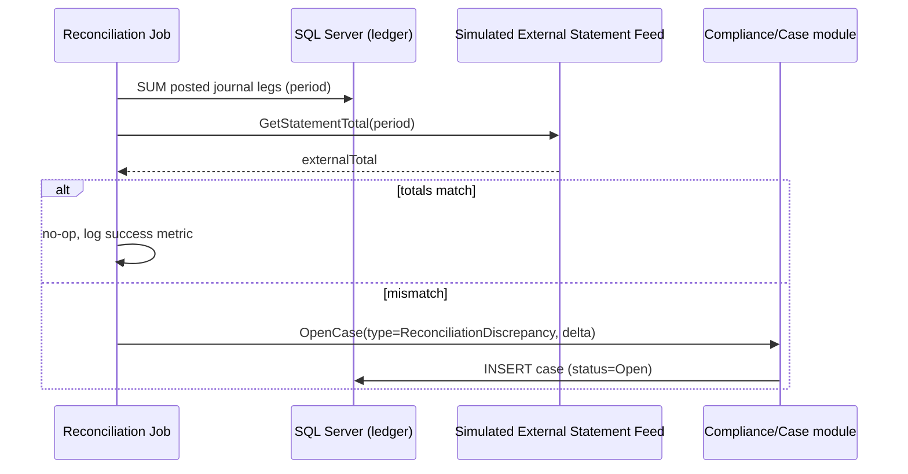

# 04 — Architecture

Diagrams at three zoom levels (C4-style: context → containers → components),
the key end-to-end flows as sequence diagrams, data ownership, failure
modes, the scaling story, and the cost story. All diagrams are Mermaid —
they render directly on GitHub.

## 1. System context (C4 level 1)

Who and what talks to Ledgerline, and what Ledgerline talks to.

**Why the two external systems are drawn as "simulated":** a real bank
integrates a real KYC vendor and reconciles against a real correspondent
statement. Neither is available to a solo portfolio project (both require
commercial agreements), so both are implemented as interfaces
(`IIdentityVerificationProvider`, `IExternalStatementFeed`) with a fixture-
backed implementation that mimics realistic latency and failure modes. This
is called out explicitly so a reviewer never mistakes the fixture for a
real integration — see [01-vision.md](01-vision.md).

## 2. Containers (C4 level 2)

**One deployable, on purpose.** Web API, outbox relay, and the
reconciliation job all run inside the same ASP.NET Core process as hosted
services, sharing one database. This is the modular-monolith choice — see
[ADR-0002](adr/0002-modular-monolith-over-microservices.md) — and it
directly addresses the Knight Capital lesson from
[00-exploration.md §1.6](00-exploration.md#16-what-happens-when-banking-software-gets-this-wrong):
there is no way for one part of the system to run old code while another
part runs new code, because there's only one deployable to version and
roll out.

## 3. Components inside the API (C4 level 3)

**Module boundary rule:** a module may only read/write its own tables
directly. Cross-module interaction happens through an in-process mediator
call (a command/query object), never a raw SQL join across module-owned
tables. This is the one discipline that keeps "modular monolith" from
quietly becoming "one big tangled monolith" — and it's exactly the
discipline that makes a future extraction into real services (if ever
warranted) mechanical rather than a rewrite.

## 4. Key flows — sequence diagrams

### 4.1 Happy-path transfer (not flagged by any rule)

### 4.2 Flagged transfer — hold, review, resolve (the saga)

This is the system's one genuine **saga**: "hold funds → external decision
(a human, standing in for what could later be an automated review) →
compensate." Each step is a local transaction with a compensating action if
the flow doesn't complete — the textbook saga shape from
[00-exploration.md §1.2-1.3](00-exploration.md#12-idempotency-and-exactly-once-money-movement),
applied to a place in this system that actually needs it (a review flow
with a human-scale duration, not a millisecond-scale posting). See
[05-design-patterns.md](05-design-patterns.md) for why the *happy-path*
transfer in §4.1 deliberately does **not** use a saga — a single DB
transaction is simpler and sufficient there, and using a saga anyway would
be the exact kind of pattern-for-its-own-sake this project is trying not to
do.

### 4.3 Reconciliation

## 5. Data ownership

| Module | Tables owned | Never written by another module |
|---|---|---|
| Accounts | `Accounts`, `AccountOwners` | ✓ |
| Ledger | `JournalEntries`, `JournalLegs`, `BalanceProjections` | ✓ |
| Transfers | `TransferRequests`, `IdempotencyKeys` | ✓ |
| Fraud/AML | `FraudRules`, `RuleEvaluations` | ✓ |
| Compliance/Case | `Cases`, `CaseResolutions` | ✓ |
| Audit | `AuditLog` | ✓ (write-only from every module's domain events, read by Compliance/SupportOps roles) |
| Outbox (infrastructure, not a domain module) | `OutboxMessages` | written in the same transaction as the module that raised the event |

All tables live in **one SQL Server database** (single deployable, single
data store — see [ADR-0002](adr/0002-modular-monolith-over-microservices.md)),
but ownership is enforced at the **code layer** (only one module's
repository/DbContext-partial touches a given table) so the boundary is real
even though the database isn't physically split. This is the concrete
mechanism behind the "composable banking" shape referenced in
[00-exploration.md §1.1](00-exploration.md#11-how-real-ledgercore-banking-systems-are-built) —
module boundaries that would let a future team physically split the
database per module without a rewrite, without paying that operational cost
today.

## 6. Failure modes

| Failure | What happens | Why this is safe |
|---|---|---|
| DB unavailable mid-request | Request fails with `503`; no partial write, because the journal-leg insert and balance update are in one transaction | ACID transaction guarantees atomicity |
| Process crashes after DB commit, before outbox relay publishes | Event is still in the `OutboxMessages` table (written in the same committed transaction); relay picks it up on restart | Outbox pattern — publish is decoupled from commit, but never lost, because the write to the outbox table *is* the commit |
| Service Bus unavailable | Outbox relay retries with backoff; pending events accumulate in the table (bounded by disk, monitored via NFR-6/outbox-lag metric) | The system of record (the journal) is unaffected — only async side effects (notifications, projections) are delayed |
| Duplicate message delivery from Service Bus (at-least-once delivery) | Consumers are idempotent — they check/record a processed-message ID before acting | Standard at-least-once + idempotent-consumer pattern |
| Two transfers race on the same source account | Row-level locking on the balance projection (`SELECT ... FOR UPDATE`-equivalent via EF Core's pessimistic concurrency, or optimistic concurrency token + retry) inside the same DB transaction that posts the journal | See NFR-1; the losing transaction retries or fails cleanly, never partially posts |
| Idempotency key reused for a *different* payload | Rejected with `422` — the dedupe check compares a hash of the request body, not just the key, so a key collision with different intent is caught rather than silently returning the wrong prior result | Prevents a subtle class of bug where a client reuses a key by mistake |
| Two requests with the *same* idempotency key arrive genuinely concurrently (not a sequential retry) | `IdempotencyKeys.Key` has a DB-level unique constraint; both requests attempt an insert, exactly one wins, the loser catches the uniqueness violation and reads back the winner's stored result instead of proceeding | The dedupe guarantee holds even for a true race, not just for retries that happen to arrive after the first one finished — an app-level "check then insert" without the DB constraint would have this exact race |
| Poison message in the outbox relay (repeatedly fails to publish) | After N retries, moved to a dead-letter table/queue and alerted on, rather than blocking the relay indefinitely | Prevents one bad event from starving all other pending events |
| Clock skew between API instances (multi-instance cloud deployment) | Idempotency-key expiry and rule time-windows (e.g. "24h aggregate") use the database server's clock (`SYSUTCDATETIME()`), not instance-local clocks | Removes clock skew as a source of inconsistent decisions |

## 7. Scaling story

**Current target (NFR-8):** ~50 req/s sustained on a single App Service B1
instance. This is a demo-scale target, stated honestly as such.

**Next step (would not require a rewrite):** the API is stateless — all
state lives in SQL Server and Service Bus — so horizontal scaling is just
adding App Service instances behind the built-in load balancer. The
database becomes the bottleneck first, at which point:

1. **Read traffic** (balance checks, statements, case queries) moves to a
   read replica, exactly the CQRS-without-event-sourcing shape from
   [00-exploration.md §1.1](00-exploration.md#11-how-real-ledgercore-banking-systems-are-built) —
   this is *documented* as the next step, not built, because a single-
   instance demo has no read load worth splitting.
2. **Write traffic** on the ledger scales by sharding the journal by
   account ID (a real bank's ledger is sharded this way) — a bigger change,
   Acknowledged only.
3. The outbox relay would shard by a hash of the aggregate ID to
   parallelize publishing once single-instance throughput became the
   bottleneck (it isn't, at this scale).

**What's explicitly out of scope even as a "next step":** multi-region
active-active, geo-partitioned data residency, and full event sourcing with
replay/snapshotting. These are real, large pieces of core-banking
engineering that a real bank's platform team owns collectively — see
[06-component-inventory.md](06-component-inventory.md), tier: Acknowledged,
for what each would require and why building even a slice of them wouldn't
be credible as solo, 2-4-week work.

## 8. Cost story

Two deployment modes, both real and both runnable:

### Local (required baseline, Hard Rule 8 — $0)

`docker compose up` runs: the API, a SQL Server container, and the Azure
Service Bus emulator container (Microsoft ships an official emulator so the
*same* messaging technology and client code run locally and in the cloud —
see [ADR-0004](adr/0004-messaging-technology.md)). No cloud account
required to clone and run the whole system.

### Cloud (optional, live demo link — target ≤$25-30/month)

| Service | Tier | Est. monthly cost | Notes |
|---|---|---|---|
| Azure App Service | Basic B1 (1 core, 1.75GB) | ~$13 | Hosts the single deployable |
| Azure SQL Database | General Purpose Serverless, 1 vCore, auto-pause after 60 min idle | ~$5-15 | Auto-pause is what makes this viable at demo traffic levels — a portfolio demo is idle most of the time |
| Azure Service Bus | Basic tier | ~$0-1 | Pay-per-operation; demo volume is a few thousand ops/month, effectively free |
| Application Insights | Pay-as-you-go | $0 | First 5GB ingested/month is free; a demo won't approach that |
| Azure Key Vault | Standard | ~$0.50 | Secrets storage, negligible at this call volume |
| **Total** | | **~$20-30/month** | |

These are estimates from public Azure pricing as understood at time of
writing (September 2026); Azure's own pricing pages require the interactive
calculator to render exact current numbers (confirmed while researching
this doc — the static pages show placeholders), so **the actual figure is
re-verified against the Azure Pricing Calculator immediately before first
deployment**, and that verification step is itself in
[08-build-plan.md](08-build-plan.md) rather than assumed. The deployment
runs continuously at this cost for the duration of the job search — see
[ADR-0003](adr/0003-deployment-and-hosting.md) for the full reasoning,
including the pause/resume runbook kept as an optional step for later
(e.g. once a job is landed), not a routine cost-saving measure.
